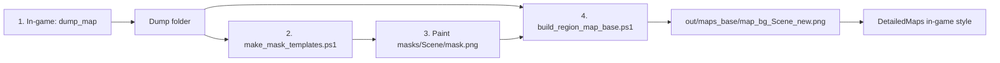

# TerrainDumper

MelonLoader utility mod for *The Long Dark*. Dumps Unity terrain heightmaps and map-alignment metadata from the **currently loaded** region so charcoal-style maps can be built offline (no photogrammetry).

## Workflow

Every ship map goes through four steps. Exclusion masks are **required** for every region.

```text
1. In-game dump          dump_map
2. Mask template         make_mask_templates.ps1  →  masks/<Scene>/template.png
3. Paint mask (manual)   export exclude layer     →  masks/<Scene>/mask.png
4. Build base map        build_region_map_base.ps1 →  out/maps_base/map_bg_<Scene>_new.png
```

Charcoal / color presentation (desat, grain, void look) is applied by **DetailedMaps** at runtime. This repo’s default export is the **base** image (levels + color balance + edge/mask fade).



### 1. Dump a region

Dumps the **active scene only**. Travel into each region (or transition zone) and run the pipeline again; there is no batch dump.

1. Launch TLD with MelonLoader + [Developer Console](https://github.com/FINDarkside/TLD-Developer-Console) (required — F1 / `uConsole`).
2. Load Survival → enter the region you want.
3. **Open the charcoal map once** (so `FogOfWar` + alignment populate), then close it.
4. Press **F1** and run:

```text
dump_map
dump_map [enrichCellMeters] [orthoGrid] [tileRes]
```

Defaults: **0.25 m** enrichment cell, **8×8** ortho grid, **1024** px tiles. Pipeline order: terrain (+ fog/alignment) → enrichment names @ 2 m → enrichment → tiled ortho (forces **noon**).

Writes to `Mods/TerrainDumper/<SceneName>/`. Enrichment at 0.25 m is the large step (often hundreds of MB–GB per region and can take a long time); leave the game alone until it finishes.

**Done when** the console shows `TerrainDumper: dump_map COMPLETE → …/<SceneName>`. Progress lines are `[1/4]`…`[4/4]`. Abort lines look like `dump_map ABORT — …` (check MelonLoader log). If fog/alignment is thin you get a WARNING to open the charcoal map and re-run — do not treat that as success for ship maps.

Re-running `dump_map` while one is already in progress is ignored (`dump_map already in progress…`).

### 2–3. Exclusion mask

```text
./tools/make_mask_templates.ps1                  # all dumps under DumpRoot (overwrites templates)
./tools/make_mask_templates.ps1 LakeRegion CoastalRegion
python tools/make_mask_template.py path/to/CoastalRegion   # single region
```

Default **2 m/px**. Always overwrites `template.png` / `mask.json`; does not touch painted `mask.png`. Writes:

```text
masks/<Scene>/
  template.png   # hillshade + world grid (paint guide; regenerable, not in git)
  mask.json      # world bounds + pixel size
```

Paint areas to **exclude** on a new layer, hide the template, export that layer alone as `masks/<Scene>/mask.png` at the same pixel size. Opaque (or non-black without alpha) = excluded. This repo ships painted `mask.png` files; regenerate templates locally when you need them.

### 4. Build the map

**Default — base for DetailedMaps** (levels + color balance + fade; no grid/grain/desat/vignette):

```text
./tools/build_region_map_base.ps1 CoastalRegion
./tools/build_region_map_base.ps1 LakeRegion
./tools/run_map_bg_all_base.ps1
```

→ `out/maps_base/map_bg_<Scene>_new.png`.

**Local charcoal / color previews** (optional; DetailedMaps normally owns this look):

```text
./tools/build_region_map.ps1 CoastalRegion
./tools/build_region_map_color.ps1 AshCanyonRegion
./tools/build_region_map_nogrid.ps1 CoastalRegion
./tools/build_region_map_color_nogrid.ps1 AshCanyonRegion
```

→ `out/maps/`, `out/maps_color/`, `out/maps_nogrid*`.

All fail if the painted mask is missing. (`make_map_bg.py --no-mask` is debug-only.)

Copy the **base** PNG into DetailedMaps and rebuild that mod manually.

---

## Requirements

This repository includes the dump mod, the offline map-building tools, and exclusion masks for each region under `masks/`.

It does **not** include game data or finished maps. To produce maps you also need:

- *The Long Dark* (Survival mode) — terrain and map metadata come from the live game
- [MelonLoader](https://github.com/LavaGang/MelonLoader) **0.7.2+** — loads TerrainDumper in-game
- [Developer Console](https://github.com/FINDarkside/TLD-Developer-Console) — required to run console commands (F1)
- A dump for each region you want to build (created in-game with `dump_map`; stored under the game `Mods/TerrainDumper` folder and not committed to git)
- Environment variable `TLD_PATH` set to your game install directory (or `TERRAIN_DUMPER_ROOT` if dumps live elsewhere)
- Python packages from `requirements.txt` for the offline tools
- .NET 6 SDK to build the mod DLL (or use a pre-built `TerrainDumper.dll`)

A complete `dump_map` run writes height data, fog-of-war and alignment metadata, plus optional enrichment and top-down imagery used by the map builder. Painted masks live in this repo (`masks/<Scene>/mask.png`). Generated map images under `out/` stay on your machine.

Requires game **2.59+** (FogOfWar textures load via Addressables handles). The project references NuGet Il2Cpp assemblies **2.55** and swaps in the local MelonLoader `Assembly-CSharp.dll` from `TLD_PATH` at build time.

## Install

1. Set `TLD_PATH` to your game install folder (e.g. `...\steamapps\common\TheLongDark`). Optionally set `TERRAIN_DUMPER_ROOT` if dumps live elsewhere (defaults to `%TLD_PATH%\Mods\TerrainDumper`).
2. Build (`dotnet build -c Release`), or copy `bin/Release/net6.0/TerrainDumper.dll`.
3. Place the DLL into the game `Mods/` folder (PostBuild does this when `TLD_PATH` is set and `Mods` exists).
4. Install Developer Console into `Mods/` as well (`DeveloperConsole.dll`).
5. Install Python dependencies: `pip install -r requirements.txt`.

## Dump output (`formatVersion` 2)

| File | Meaning |
|---|---|
| `meta.json` | Scene name, timestamp, mod/game version, tile list |
| `terrain_NN_heights.raw` | LE `uint16` heights; `round(normalized * 65535)` |
| `terrain_NN_meta.json` | Resolution, size, transform, world bounds |
| `terrain_NN_preview.png` | Grayscale quick-look |
| `fog_of_war.json` | FogOfWar scales/offsets/radii (open charcoal map once before dump) |
| `alignment_samples.json` | `WorldPositionToMapPosition` samples |
| `enrichment_*.raw` / `enrichment_meta.json` | Collider raycast heights + HitClass; v4 adds `enrichment_rock_kind.raw` / `enrichment_rock_snow.raw` |
| `ortho_color_tiled/` | Tiled top-down color capture |

Normalized height → meters ≈ `normalized * size.y + position.y`.

**World → map:** authoritative samples in `alignment_samples.json`. Image UV frame from fog → `±(mapRadiusConstant / detailScale)`. Missing fog is a hard error; `--map-radius` / `--sample-extent` are opt-in only.

## Offline tools

```text
./tools/make_mask_templates.ps1
python tools/make_mask_template.py path/to/<Scene>
python tools/make_map_bg.py path/to/<Scene> --size 4096 --out out/maps/map_bg_<Scene>_new.png
python tools/make_map_bg.py path/to/<Scene> --size 4096 --pipeline color --out out/maps_color/map_bg_<Scene>_color.png
./tools/build_region_map_base.ps1 <Scene>
./tools/run_map_bg_all_base.ps1
./tools/build_region_map.ps1 <Scene>
./tools/build_region_map_color.ps1 <Scene>
./tools/build_region_map_nogrid.ps1 <Scene>
./tools/build_region_map_color_nogrid.ps1 <Scene>
python tools/preview_heights.py path/to/<Scene>
python tools/check_alignment.py path/to/<Scene> path/to/map_bg.png alignment_check.png
python tools/make_fow_config.py path/to/<Scene>
python tools/make_fow_config.py path/to/MountainPassRegion --validate
python tools/synth_alignment_from_fow.py path/to/<Scene>
```

Needs `numpy` + `Pillow` (+ `scipy` for inset/mask grow); see `requirements.txt`. Build scripts resolve the dump folder from `TLD_PATH` / `TERRAIN_DUMPER_ROOT` (or `-DumpRoot`).

### Offline FOW config (`make_fow_config.py` / `synth_alignment_from_fow.py`)

For **Mod** scenes (and offline framing), `make_fow_config.py` derives FogOfWar scalars from DEM meta. `sceneRadius` = half-diagonal of the playable-land AABB union. Emits `mapRadiusConstant` (Panel_Map.MAP_RADIUS=300 for charcoal UV) separately from `mapRadius` (FogOfWar.m_MapRadius≈900). Writes `<dump>/fow.json` and `masks/<Scene>/fow.json`. `synth_alignment_from_fow.py` builds a matching `alignment_samples.json` from that config. Shipping/enabling FOW in-game is a separate companion step.

On vanilla regions, prefer live `fog_of_war.json` + `alignment_samples.json` from `dump_map` after opening the charcoal map once (TLD **2.59**+).

### `make_map_bg` notes

- Default export for DetailedMaps is **base** (`build_region_map_base.ps1`: levels + color balance + fade; no grid/grain/desat/vignette).
- Optional local presentation pipelines share the same DEM/ortho/enrichment/mask/rock-texture path:
  - `--pipeline charcoal`: full desaturate → shared levels → cool dim-gray void → grid/stipple/vignette/grain.
  - `--pipeline color`: keep 80% chroma → same levels → same void tint → same overlays.
  - No-grid wrappers pass `--no-grid` and write to `out/maps_nogrid` or `out/maps_color_nogrid`.
- Default size: **4096** wide, height from fog UV aspect. Void: edge fade 80 m then black/alpha over 300 m; signed-distance blur 36 m.
- Rock fill uses TLD albedo tiles from `out/textures/tld_rock_samples/` when present (`--no-rock-textures` for flat fill).
- Auto-uses `ortho_color_tiled` + enrichment when present.
- Border = terrain DEM footprint; enrichment merges **inside** only.
- Mask only subtracts from `valid`; map extent / POI affine are unchanged.
- Useful flags: `--pipeline`, `--mask`, `--mask-grow-m`, `--no-mask` (debug), `--no-enrichment`, `--style charcoal`, `--no-ship-post`, `--edge-fade-m`, `--grid-scope`.

### Other in-game commands

| Command | What |
|---|---|
| `dump_ortho_tiled [grid] [tileRes]` | Classic tiled hi-LOD ortho (+ fog kill); defaults 8 / 1024 |
| `dump_ortho_tiled_land [grid] [tileRes]` | Land-mode: player stream-wake land pass (water off) + water/void remainder into same atlas → `ortho_color_tiled_land.png` |
| `dump_enrichment [cellMeters]` | Collider heights (default 0.25 m) |
| `dump_enrichment_all [cellMeters] [rowsPerFrame] [scenes…]` | Unattended OnUpdate batch: load each region, wait ready/terrain, `dump_enrichment`, next. Defaults match `dump_climbing_all` scene list. Keeps ticking while unfocused. `dump_enrichment_all_abort` cancels (aborts in-progress region). |
| `dump_ortho` / `dump_ortho_clean` | Single-shot ortho |
| `dump_walkable [cellMeters] [rasterize]` | NavMesh triangulation (+ optional XZ raster; default cell 4, raster 1). Also runs `dump_portals`. |
| `dump_portals` | `LoadScene` contacts + ExitPoint/EnterPoint markers → `portals.json` |
| `dump_pois` | `DisplayLocationLabel` + `MapDetail` positions → `pois.json` |
| `dump_fallen_logs` | Fallen / bridge / tree-log prop roots (name-matched) → `fallen_logs.json` (broad kinds for offline filter; not part of `dump_map`) |
| `dump_climbing` | Rope climbs + scramble climbs (with length) → `climbing.json` (not part of `dump_map`) |
| `dump_climbing_all [scenes…]` | Unattended: load each region (`LoadSceneWithLoadingScreen` / `scene`), wait ready, `dump_climbing`, next. No args = outdoor/transition list including `BlackrockPrisonSurvivalZone`. `dump_climbing_all_abort` cancels after the current scene. |

No dump hotkeys — console only (accidental F-keys were overwriting dumps). Trees/walkable are not part of the ship pipeline. Individual dump commands still work alongside `dump_map`.

## Safety

Most dumps are read-only: no `SetHeights`, no save/settings mutation. `dump_climbing_all` / `dump_enrichment_all` **do** change scenes (same as console `scene`).

## Build

```text
dotnet build TerrainDumper.csproj -c Release
```
